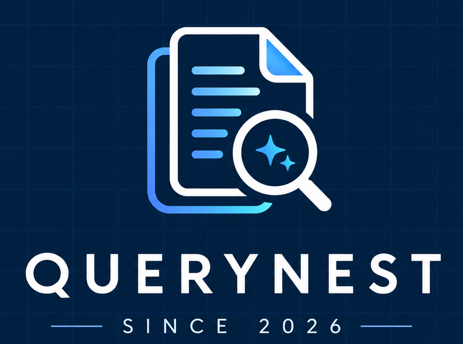

# QueryNest — AI Document Knowledge Workspace

> **Your documents. Your answers.**



QueryNest is an AI-powered document knowledge workspace built with the **MERN stack** and **Local LLM runtime (Ollama)**. Instead of answering from general model knowledge alone, QueryNest retrieves relevant passages from uploaded PDF documents and provides precise, verifiable answers grounded directly in document evidence with inspectable page references and excerpts.

---

## 1. Product Identity & Branding

- **Product Name:** QueryNest
- **Tagline:** Your documents. Your answers.
- **Brand Palette:**
  - Deep Navy: `#10131F` (Background & canvas)
  - Secondary Navy: `#0B2A45` (Cards & elevated panels)
  - Accent Violet: `#9A8BFA` (Primary buttons & brand highlights)
  - Accent Teal: `#6BDDD1` (Source citations & verified badges)
  - Clean Whites & Muted Neutrals: `#F8FAFC`, `#94A3B8`
- **Typography:** Inter & Manrope
- **Official Brand Assets:**
  - Full Brand Lockup: `client/public/querynest-logo.png`
  - Compact Icon Variant: `client/public/querynest-icon.png`
  - Browser Favicon: `client/public/favicon.png`

---

## 2. System Architecture & RAG Pipeline

QueryNest implements a complete **Retrieval-Augmented Generation (RAG)** pipeline:

```
[ PDF Upload (React UI) ]
          │
          ▼
[ Express API + Multer ] ─── (Validates Magic Bytes '%PDF-' & 15MB Limit)
          │
          ▼
[ pdf-parse Extraction ] ─── (Extracts text, numpages & per-page text)
          │
          ▼
[ Overlapping Chunking ] ─── (250-300 words with 50-word overlap + page mapping)
          │
          ▼
[ Ollama Embeddings ] ───── (Generates vectors via local 'embeddinggemma')
          │
          ▼
[ MongoDB Atlas ] ───────── (Stores metadata in 'documents', vectors in 'chunks')
          │
          ▼
[ User Question ] ───────── (Question embedded via 'embeddinggemma')
          │
          ▼
[ Atlas Vector Search ] ─── ($vectorSearch on 'embedding' + filter by documentId)
          │
          ▼
[ Grounded Synthesis ] ──── (Local 'llama3.2:3b' answers strictly from retrieved context)
          │
          ▼
[ Verifiable Response ] ─── (Displays markdown answer + page numbers & excerpt cards)
```

> **Data Flow & Privacy Boundary Note:**
> Ollama runs model inference locally on your computer. However, MongoDB Atlas stores document metadata, text chunks, and vector search indices in the cloud. QueryNest is a hybrid local-inference / cloud-database architecture.

---

## 3. Technology Stack

- **Frontend:** React 19, Vite, React Router 7, Lucide Icons, Pure CSS Design System tokens
- **Backend:** Node.js, Express.js (ES Modules)
- **Database:** MongoDB Atlas, Mongoose ODM
- **Vector Search:** MongoDB Atlas Vector Search (`$vectorSearch` aggregation stage)
- **AI Inference Engine:** Ollama (local daemon)
  - Chat Model: `llama3.2:3b`
  - Embedding Model: `embeddinggemma`
- **PDF Extraction:** `pdf-parse` (per-page text extraction and scanned document detection)
- **File Ingestion:** Multer (safe file naming, mime verification, size limits)

---

## 4. Repository Structure

```
RAG/
├── client/                     # React + Vite Frontend
│   ├── public/                 # Static assets & QueryNest logos
│   │   ├── querynest-logo.png  # Approved full lockup
│   │   ├── querynest-icon.png  # Compact icon variant
│   │   └── favicon.png         # Browser favicon
│   ├── src/
│   │   ├── components/         # Navbar, UploadBox, ChatMessage, SourceCard, Modal, StatusBadge
│   │   ├── pages/              # Home, Workspace, Documents, History, Settings
│   │   ├── context/            # AppContext (global state & health monitoring)
│   │   ├── services/           # API client service
│   │   ├── styles/             # theme.css & index.css (Navy/Violet/Teal design system)
│   │   ├── App.jsx             # React Router setup
│   │   └── main.jsx
│   ├── index.html
│   ├── vite.config.js          # Dev server & /api proxy to port 5000
│   └── package.json
│
├── server/                     # Express.js Backend
│   ├── src/
│   │   ├── config/             # MongoDB connection (db.js)
│   │   ├── models/             # Document.js, Chunk.js, Conversation.js
│   │   ├── routes/             # healthRoutes, documentRoutes, chatRoutes, historyRoutes
│   │   ├── controllers/        # Request orchestration & response handling
│   │   ├── services/           # pdfService, chunkingService, ollamaService, vectorService, ragService
│   │   ├── middleware/         # uploadMiddleware, errorHandler
│   │   ├── utils/              # logger.js
│   │   ├── app.js              # Express app middleware & route bindings
│   │   └── server.js           # Entrypoint & startup health check
│   ├── uploads/                # Temporary upload staging (gitignored)
│   ├── .env.example            # Environment template
│   ├── .env                    # Local environment configuration
│   └── package.json
│
├── .gitignore
├── package.json                # Root orchestration scripts
└── README.md
```

---

## 5. Prerequisites

1. **Node.js**: v18.0.0 or later (Tested on Node v24 LTS)
2. **Ollama**: Download and install from [ollama.com](https://ollama.com)
3. **MongoDB Atlas Account**: Free Tier (M0) or dedicated cluster on MongoDB Atlas

---

## 6. Installation & Setup

### Step 1: Install Dependencies

From the workspace root directory:

```bash
# Install server dependencies
cd server
npm install

# Install client dependencies
cd ../client
npm install
```

### Step 2: Download Ollama Models

Open a terminal and pull the designated models:

```bash
# Pull and test the chat model
ollama run llama3.2:3b

# Pull the embedding model
ollama pull embeddinggemma
```

Ensure the Ollama application remains running in the background (default port `http://127.0.0.1:11434`).

### Step 3: Configure Environment Variables

Edit `server/.env` (created from `server/.env.example`):

```env
# Server Port
PORT=5000

# MongoDB Atlas Connection URI
# Replace with your actual Atlas connection string
MONGODB_URI=mongodb+srv://<username>:<password>@cluster0.xxxxx.mongodb.net/querynest?retryWrites=true&w=majority

# Ollama Local Service Configuration
OLLAMA_URL=http://127.0.0.1:11434
CHAT_MODEL=llama3.2:3b
EMBED_MODEL=embeddinggemma

# Vector Search Index Configuration
VECTOR_INDEX_NAME=vector_index
EMBEDDING_DIMENSIONS=768

# Upload & File Limits
MAX_FILE_SIZE_MB=15

# Chunking Strategy Configuration
CHUNK_SIZE_WORDS=250
CHUNK_OVERLAP_WORDS=50

# Development Fallback (Optional)
# Set to true if you wish to test in-memory vector cosine similarity before the Atlas index finishes building
ALLOW_COSINE_FALLBACK=true
```

### Step 4: Configure MongoDB Atlas Vector Search Index

1. Log into [cloud.mongodb.com](https://cloud.mongodb.com).
2. Go to your cluster &rarr; **Atlas Search / Vector Search** tab.
3. Click **Create Search Index** &rarr; Select **JSON Editor**.
4. Select your Database (e.g., `querynest`) and Collection: `chunks`.
5. Set Index Name to: `vector_index`.
6. Paste the following JSON definition:

```json
{
  "fields": [
    {
      "type": "vector",
      "path": "embedding",
      "numDimensions": 768,
      "similarity": "cosine"
    },
    {
      "type": "filter",
      "path": "documentId"
    }
  ]
}
```

7. Click **Create Vector Search Index**.

---

## 7. Running the Application

### Option A: Run Both Simultaneously

In terminal 1 (Backend):
```bash
cd server
npm run dev
```

In terminal 2 (Frontend):
```bash
cd client
npm run dev
```

### Option B: Open the Application

Open your browser at:
```
http://localhost:5173
```

---

## 8. API Reference

| Method | Endpoint | Description |
|---|---|---|
| `GET` | `/api/health` | Comprehensive system health check (API, MongoDB Atlas, Ollama, Vector Search) |
| `POST` | `/api/documents/upload` | Multipart upload of a PDF document; extracts text, chunks, embeds, and indexes |
| `GET` | `/api/documents` | Lists all uploaded documents with metadata and processing status |
| `GET` | `/api/documents/:id` | Returns document metadata and sample chunk passages |
| `DELETE` | `/api/documents/:id` | Cascades deletion of document and its associated vector chunks |
| `POST` | `/api/chat` | Submits question against selected document; executes RAG retrieval and returns answer with citations |
| `GET` | `/api/history` | Retrieves list of saved conversation threads |
| `GET` | `/api/history/:id` | Returns complete message thread and source excerpts for a conversation |
| `DELETE` | `/api/history/:id` | Deletes a conversation thread |

---

## 9. Key Features & Acceptance Verification

1. **Text Extraction & Ingestion Verification**:
   - Accepts `.pdf` files up to 15MB.
   - Enforces binary magic bytes (`%PDF-`).
   - Automatically detects scanned or image-only PDFs and warns the user that OCR is required.
2. **Chunking & Embeddings**:
   - Splits text into overlapping segments (default 250 words with 50-word overlap) while preserving page numbers.
   - Generates high-dimensional vector embeddings via Ollama.
3. **Atlas Vector Search Retrieval**:
   - Queries top-$k$ relevant chunks using Atlas `$vectorSearch` with document filtering.
   - Displays clear actionable error instructions if the search index is not yet built.
4. **Strict Grounding & Honest Failures**:
   - If user asks about topics not present in the document, QueryNest explicitly responds:
     *"I could not find any relevant information in [document] to answer your question."*
   - Never hallucinates citations or fabricates page numbers.
5. **Inspectable Citations**:
   - Every grounded assistant response includes collapsible cards with the document name, exact page number, chunk ID, relevance match percentage, and full text passage modal.
6. **Live Settings & Diagnostics**:
   - The `/settings` page provides live connectivity test buttons for Express API, MongoDB Atlas, and Ollama, alongside one-click copy buttons for terminal commands and Atlas index definitions.

---

## 10. Security & Limitations

- **Single-User Prototype Scope:** This version operates as a single-user local prototype. Authentication, authorization (e.g. JWT / OAuth), and multi-tenant document isolation must be added prior to any public internet deployment.
- **Scanned PDFs:** PDFs containing only scanned raster images cannot be read by `pdf-parse` without OCR. Text-based PDFs are fully supported.
- **Local Compute:** Inference speed and responsiveness depend on local CPU/GPU hardware. A minimum of 16 GB RAM is recommended for 3B parameter models.

---

## License

QueryNest is released under the ISC License.
